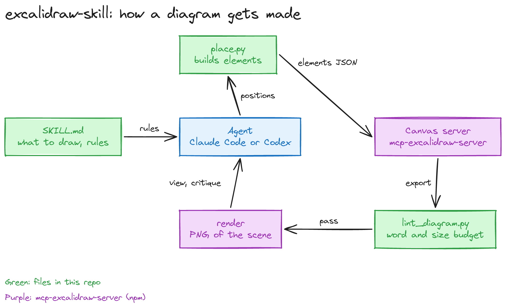
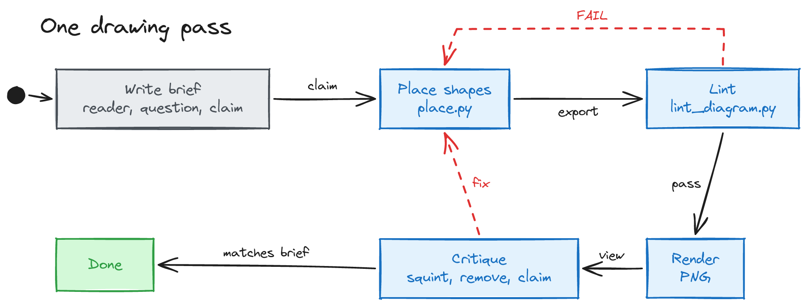

# excalidraw-skill

An agent skill for Claude Code and Codex. It draws diagrams that explain code, code changes, designs, and concepts on a live Excalidraw canvas. `SKILL.md` sets what to draw and how to compose it. `scripts/place.py` lays out boxes and arrows, and `scripts/lint_diagram.py` checks a diagram's word budget.

## How it works

The agent reads `SKILL.md` to decide what to draw. It chooses box positions on a grid and passes them to `place.py`. `place.py` sizes the boxes, routes the arrows, and prints Excalidraw elements as JSON. The agent pipes that JSON to the `mcp-excalidraw-server` CLI, which draws the elements on a local canvas server.

The agent then exports the scene and runs `lint_diagram.py`. The lint checks the box count, the words per label, the number of colors, and the aspect ratio. When the lint passes, the CLI renders the scene to a PNG without a browser. The agent views the PNG and critiques it against its brief.

Each drawing starts with a four-line brief: the reader, their question, the claim the picture must prove, and the diagram type. A lint failure or a failed critique sends the agent back to change the layout. The pass ends when the picture proves the claim in the brief.

Both diagrams on this page came from this skill.

## Install

Clone the repo and link it into your skills directory:

    git clone https://github.com/dbanks12/excalidraw-skill.git
    ln -s "$(pwd)/excalidraw-skill" ~/.claude/skills/excalidraw-skill
    ln -s "$(pwd)/excalidraw-skill" ~/.codex/skills/excalidraw-skill

The skill needs Node.js with `npx`. It runs the canvas through `npx -y mcp-excalidraw-server@2.1.2` or later, which starts a canvas server at `http://127.0.0.1:3000`. The scripts need Python 3.

## Attribution

This skill started from the `excalidraw-skill` that ships with [mcp-excalidraw-server](https://github.com/yctimlin/mcp_excalidraw) by yctimlin, under the MIT license. `references/mechanics.md` and `references/cheatsheet.md` are upstream text. `evals/evals.json` extends the upstream evals. `SKILL.md` and `scripts/` are new. See `LICENSE`.
